# VP Mart – Database Architecture & Entity Relationship Diagram
## MongoDB Data Model Specification

This document provides the complete database architecture for VP Mart based on the actual 27 Mongoose models implemented in `backend/src/models/`.

---

## 1. Entity Relationship Diagram (ERD)

```mermaid
erDiagram
    User ||--o{ Session : "has many"
    User ||--o{ Address : "has many"
    User ||--o| VendorProfile : "has one"
    User ||--o| DeliveryAgentProfile : "has one"
    User ||--o{ Cart : "has one"
    User ||--o{ Order : "places many"
    User ||--o{ Notification : "receives many"
    User ||--o{ Review : "writes many"

    VendorProfile ||--o{ Listing : "owns many"
    VendorProfile ||--o{ Shipment : "originates many"
    VendorProfile ||--o{ Settlement : "receives many"
    VendorProfile ||--o{ LedgerEntry : "records many"

    Category ||--o{ Category : "parent of"
    Category ||--o{ Product : "classifies"
    Brand ||--o{ Product : "manufactures"
    Product ||--o{ Listing : "listed as"
    Product ||--o{ Review : "receives"

    Order ||--|{ OrderItem : "contains"
    Order ||--|{ Shipment : "fulfilled via"
    Order ||--o| Payment : "settled via"
    Order ||--o{ Refund : "may have"

    Listing ||--o{ OrderItem : "sold in"
    Shipment ||--o{ OrderItem : "packs"
    Shipment }o--|| DeliveryAgentProfile : "assigned to"

    Coupon ||--o{ CouponRedemption : "tracks usage"
    Order ||--o{ CouponRedemption : "applies"
    Payment ||--o{ Refund : "originates"

    User {
        ObjectId _id PK
        string email UK
        string passwordHash
        string name
        string role "buyer | vendor | admin | delivery_agent"
        string status "active | suspended | pending_approval"
        string phone
        string avatarUrl
        date createdAt
    }

    Session {
        ObjectId _id PK
        ObjectId userId FK
        string tokenHash
        string prevTokenHash
        date expiresAt
        date revokedAt
        string userAgent
        string ip
    }

    VendorProfile {
        ObjectId _id PK
        ObjectId userId FK, UK
        string businessName
        string pan
        string gstin
        object bankAccount
        number commissionRate
        string status "draft | pending_approval | active | suspended"
    }

    DeliveryAgentProfile {
        ObjectId _id PK
        ObjectId userId FK, UK
        string vehicleType
        string vehicleNumber
        string licenseNumber
        boolean isAvailable
        number activeDeliveryCount
        string status "pending_approval | active | suspended"
    }

    Product {
        ObjectId _id PK
        ObjectId vendorId FK
        ObjectId brandId FK
        ObjectId categoryId FK
        string name
        string slug UK
        string description
        array attributes
    }

    Listing {
        ObjectId _id PK
        ObjectId vendorId FK
        ObjectId productId FK
        string sku UK
        number pricePaise
        number mrpPaise
        number stock
        array images
        string moderationStatus "approved | pending | rejected"
        boolean isActive
    }

    Cart {
        ObjectId _id PK
        ObjectId userId FK, UK
        array items
        date updatedAt
    }

    Address {
        ObjectId _id PK
        ObjectId userId FK
        string fullName
        string phone
        string addressLine1
        string addressLine2
        string city
        string state
        string postalCode
        boolean isDefault
    }

    Order {
        ObjectId _id PK
        ObjectId buyerId FK
        string orderNumber UK
        object addressSnapshot
        number totalAmountPaise
        number itemDiscountPaise
        number couponDiscountPaise
        number shippingFeePaise
        number taxPaise
        string status "pending_payment | confirmed | processing | shipped | delivered | cancelled"
        string paymentMethod "online | cod"
        string paymentStatus "pending | paid | failed | refunded"
    }

    OrderItem {
        ObjectId _id PK
        ObjectId orderId FK
        ObjectId shipmentId FK
        ObjectId vendorId FK
        ObjectId listingId FK
        string title
        number quantity
        number pricePaise
        number taxPaise
        string status
    }

    Shipment {
        ObjectId _id PK
        ObjectId orderId FK
        ObjectId vendorId FK
        ObjectId deliveryAgentId FK
        string trackingNumber UK
        string status "packing | pickup_requested | picked_up | in_transit | out_for_delivery | delivered | failed | returned"
        string deliveryOtp
        date dispatchDate
        date deliveredDate
    }

    Payment {
        ObjectId _id PK
        ObjectId orderId FK, UK
        string provider "razorpay | razorpay_dummy"
        string providerOrderId
        string providerPaymentId
        number amountPaise
        string currency
        string status "created | authorized | captured | failed | refunded"
        string signature
    }

    Coupon {
        ObjectId _id PK
        string code UK
        string title
        string discountType "fixed | percent"
        number value
        number minPurchasePaise
        number maxDiscountPaise
        date validFrom
        date validTo
        boolean appliesToAll
        array productIds
        number usageLimit
        number usedCount
        boolean isActive
    }
```

---

## 2. Detailed Collection & Schema Breakdown

### 2.1 User Management & Identity
1. **`users` (`User.js`)**:
   - `_id`: Primary identifier.
   - `email`: Indexed, unique, lowercase, trimmed.
   - `role`: Enum `['buyer', 'vendor', 'admin', 'delivery_agent']`.
   - `status`: Enum `['active', 'suspended', 'pending_approval']`.
   - `failedLoginAttempts`, `lockoutUntil`: Account lockout security fields.
2. **`sessions` (`Session.js`)**:
   - `userId`: Reference to `users._id`.
   - `tokenHash`: SHA-256 hash of the cryptographically random refresh token.
   - `expiresAt`: TTL index for automated MongoDB document eviction upon session expiry.
   - `revokedAt`: Used for token revocation and immediate theft detection.

### 2.2 Vendor & Logistics Profiles
3. **`vendorprofiles` (`VendorProfile.js`)**:
   - `userId`: Reference to `users._id` (Unique, 1-to-1).
   - `businessName`, `pan`, `gstin`: Legal compliance identifiers.
   - `bankAccount`: Encrypted or masked bank payout information (`accountNumber`, `ifsc`, `bankName`).
   - `status`: Lifecycle indicator (`draft` -> `pending_approval` -> `active` -> `suspended`).
4. **`deliveryagentprofiles` (`DeliveryAgentProfile.js`)**:
   - `userId`: Reference to `users._id` (Unique, 1-to-1).
   - `vehicleType`, `vehicleNumber`, `licenseNumber`: Operational credentials.
   - `activeDeliveryCount`: Concurrency limiter to prevent agent overload.
   - `isAvailable`: Real-time dispatch availability flag.

### 2.3 Catalog, Products & Listings
5. **`categories` (`Category.js`)**:
   - `slug`: Unique human-readable URL slug.
   - `parentId`: Self-referential foreign key for hierarchical nesting (e.g. `Electronics` -> `Mobiles`).
   - `gstPercent`: Applicable taxation percentage.
   - `regulation`: Regulatory flags (`none`, `fssai`, `medicine`, `device`).
6. **`brands` (`Brand.js`)**:
   - Canonical brand reference (`name`, `slug`, `logoUrl`, `isFeatured`).
7. **`products` (`Product.js`)**:
   - Base catalog definition (`name`, `slug`, `brandId`, `categoryId`, `attributes`).
8. **`listings` (`Listing.js`)**:
   - Vendor-specific retail offer. Links a vendor to a catalog product.
   - `pricePaise`, `mrpPaise`: Stored in whole paise integers to avoid IEEE floating-point arithmetic errors.
   - `stock`: Available inventory count. Decremented atomically during order checkout.
   - `moderationStatus`: `approved`, `pending`, `rejected`.

### 2.4 Commerce, Orders & Fulfillment
9. **`orders` (`Order.js`)**:
   - `buyerId`: Reference to `users._id`.
   - `orderNumber`: Human-facing reference (e.g., `VP-20261109-8421`).
   - `addressSnapshot`: Immutable copy of delivery address at checkout time.
   - Financial totals: `totalAmountPaise`, `taxPaise`, `shippingFeePaise`, `couponDiscountPaise`.
   - `status`: State machine: `pending_payment` -> `confirmed` -> `processing` -> `shipped` -> `delivered` / `cancelled`.
10. **`orderitems` (`OrderItem.js`)**:
    - Line-level purchase records detailing SKU, purchased price, tax, and individual item status.
11. **`shipments` (`Shipment.js`)**:
    - Fulfillment container. Each multi-vendor order splits items into vendor-specific shipments.
    - `deliveryAgentId`: Reference to assigned delivery agent.
    - `deliveryOtp`: Cryptographic One-Time Password verified by the delivery agent upon handover.
12. **`payments` (`Payment.js`)**:
    - `providerOrderId`: Razorpay order ID.
    - `providerPaymentId`: Razorpay payment ID.
    - `signature`: HMAC-SHA256 signature validating payment authenticity.
13. **`refunds` (`Refund.js`)**:
    - Audit records of full or partial payment reversals.

### 2.5 Promotions, Settlements & Platform Logs
14. **`coupons` & `couponredemptions` (`Coupon.js`, `CouponRedemption.js`)**:
    - Server-enforced promotional codes supporting fixed or percentage discounts, minimum cart thresholds, and buyer eligibility.
15. **`settlements` & `ledgerentries` (`Settlement.js`, `LedgerEntry.js`)**:
    - Double-entry accounting system recording vendor net sales, platform commissions, and bank payout records.
16. **`auditlogs` (`AuditLog.js`)**:
    - Immutable security audit trail recording sensitive admin and vendor actions with actor, IP, timestamp, and metadata.
