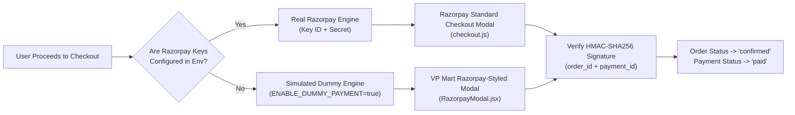

# VP Mart – System Architecture Documentation
## Comprehensive Architecture Specification

---

## 1. Architectural Overview

VP Mart follows a decoupled, three-tier enterprise web application architecture consisting of:
1. **Client Presentation Tier**: React 19 Single Page Application (SPA) hosted on Netlify's global Edge CDN.
2. **Application Server Tier**: Node.js and Express 5 modular REST and WebSocket application server hosted on Render.
3. **Data & Persistence Tier**: MongoDB Atlas multi-tenant document database with optional Redis acceleration.

### High-Level Architecture Diagram

```mermaid
flowchart TD
    subgraph Clients["User Personas & Devices"]
        BuyerClient["Buyer (Browser / Mobile)"]
        VendorClient["Vendor (Portal)"]
        AdminClient["Admin (Console)"]
        AgentClient["Delivery Agent (App)"]
    end

    subgraph HostingFrontend["Frontend Tier (Netlify Edge CDN)"]
        SPA["React 19 SPA (Vite 8 Build)"]
        Router["React Router 7 Navigation"]
        Contexts["State Contexts (Auth, Cart, Socket, Location)"]
        AxiosClient["Axios API Client (CSRF & Interceptors)"]
        SocketClient["Socket.IO Client"]
    end

    subgraph HostingBackend["Backend Application Tier (Render Web Service)"]
        ExpressApp["Express 5 Web Framework"]
        SecurityMW["Security Middleware (Helmet, CORS, Rate Limit)"]
        AuthMW["Authentication & CSRF Middleware"]
        RouteHandlers["Modular Route Controllers"]
        
        subgraph BusinessServices["Domain Service Layer"]
            CatalogSvc["Catalog & Search Service"]
            CartSvc["Cart & Pricing Service"]
            OrderSvc["Order & Settlement Service"]
            PaymentSvc["Razorpay & Simulation Engine"]
            DeliverySvc["Delivery & Logistics Service"]
            InvoiceSvc["PDFKit Invoice Engine"]
        end

        SocketServer["Socket.IO WebSocket Server"]
    end

    subgraph Persistence["Persistence & Integration Tier"]
        MongoDB[("MongoDB Atlas Database\n(27 Collections & Transactions)")]
        RedisCache[("Redis Cache\n(Optional Accelerator)")]
        StorageDriver["Storage System\n(Local Disk / AWS S3)"]
        RazorpayGateway["Razorpay Payment Gateway\n(Live / Test / Sandbox)"]
    end

    BuyerClient -->|HTTPS| SPA
    VendorClient -->|HTTPS| SPA
    AdminClient -->|HTTPS| SPA
    AgentClient -->|HTTPS| SPA

    SPA --> Router
    Router --> Contexts
    Contexts --> AxiosClient
    Contexts --> SocketClient

    AxiosClient -->|REST API Requests (withCredentials)| SecurityMW
    SecurityMW --> AuthMW
    AuthMW --> RouteHandlers
    RouteHandlers --> BusinessServices

    SocketClient <-->|WSS WebSockets| SocketServer
    BusinessServices --> SocketServer

    BusinessServices --> MongoDB
    BusinessServices --> RedisCache
    BusinessServices --> StorageDriver
    PaymentSvc <-->|API / Webhooks| RazorpayGateway
```

---

## 2. Client Tier Architecture (Frontend)

The frontend is built with React 19 and compiled using Vite 8. It utilizes a modular, component-driven hierarchy organized around layouts, contexts, and domain views.

### Context Provider Topology
1. **`AuthContext` (`AuthContext.jsx`)**:
   - Manages authentication state (`user`, `login`, `register`, `logout`).
   - Automatically synchronizes with the server session on initial load via `GET /api/auth/me`.
   - Listens for global `vp:auth-expired` events emitted by Axios response interceptors to clear state upon session expiration.
2. **`CartContext` (`CartContext.jsx`)**:
   - Maintains the client-side cart count, line items, and promotional discounts.
   - Synchronizes with `GET /api/cart` and triggers updates upon adding, updating, or clearing items.
3. **`SocketContext` (`SocketContext.jsx`)**:
   - Manages real-time bidirectional WebSocket communication.
   - Handles connection lifecycles, reconnection attempts (5 retries), and event dispatching (`notification:new`, `order:status_changed`, `pickup:requested`).
4. **`LocationContext` (`LocationContext.jsx`)**:
   - Stores user-selected delivery PIN code for serviceability and estimated delivery calculation.

### Layout Hierarchy
- **`PublicLayout` (`PublicLayout.jsx`)**: Encloses standard storefront pages with sticky header, category megamenu, search autocomplete, footer, and location modal.
- **`AuthLayout` (`AuthLayout.jsx`)**: Two-column glassmorphic authentication shell featuring animated glow orbs, brand metrics strip, and floating ecosystem feature cards.
- **`DashboardLayout` (`DashboardLayout.jsx`)**: App-style side-navigation layout used across Admin, Vendor, and Delivery Agent portals.

---

## 3. Server Tier Architecture (Backend)

The backend server is structured into clean architectural boundaries:

### Application Pipeline (`app.js`)
1. **Security & Header Isolation**: `helmet()` sets standard HTTP security headers. Express disables `x-powered-by`. `trust proxy` is set to `1` in production to respect upstream proxy headers.
2. **CORS Enforcement**: Handles incoming origins dynamically from `CLIENT_ORIGIN`, allowing Netlify production and preview deploy subdomains while supporting cross-site credentials.
3. **Body Parsing & Webhooks**: `express.json({ limit: '100kb' })` captures `rawBody` specifically for `/api/webhooks/razorpay` to enable byte-accurate HMAC signature verification.
4. **Cookie Parsing & Rate Limiting**: `cookieParser()` parses HttpOnly cookies. `makeApiLimiter()` throttles request bursts across IP addresses.
5. **Double-Submit CSRF Protection**: `csrfProtection()` validates the matching pair between `x-csrf-token` HTTP header and `vp_csrf` cookie on all mutating HTTP requests (POST, PUT, PATCH, DELETE).
6. **Error Redaction**: `errorHandler()` translates validation and database errors into safe client responses without leaking internal stack traces in production.

---

## 4. Real-Time WebSocket Architecture (Socket.IO)

Socket.IO is mounted on the shared HTTP server (`initSocketServer` in `backend/src/sockets/socket.js`).

### Room Segmentation & Security
- **Authentication Handshake**: The socket handshake verifies the user's JWT access token.
- **Room Subscriptions**:
  - `user:<userId>`: Private channel for individual user notifications and order updates.
  - `role:<role>`: Broadcast channel for role-specific events (`role:vendor`, `role:delivery_agent`, `role:admin`).
  - `order:<orderId>`: Ephemeral room joined by buyer, seller, and delivery agent for live delivery tracking.
  - `public`: Channel for broadcast catalog changes and market announcements.

---

## 5. Persistence Tier Architecture

### MongoDB Atlas Document Database
- Configured via Mongoose with strict query constraints (`strictQuery: true`).
- Uses connection pooling (`maxPoolSize: 20`) and connection timeouts (`serverSelectionTimeoutMS: 8000`).
- Models register unique indexes (e.g. `User.email`, `Coupon.code`, `Listing.sku`) and compound indexes (e.g. `Listing.vendorId + Listing.status`) before accepting traffic.

### Redis Cache Tier (`cache.js`)
- Shared cache layer for public catalog categories, featured brands, and home listings.
- **Global Invalidation Versioning**: Any catalog change bumps a global version key `catalog:ver`. All cache keys are prefixed with `c:<version>:...`, providing instant, atomic cache invalidation without expensive wildcard sweeps.
- **Graceful Fallback**: If Redis is not configured or offline, cache helper functions detect `null` and seamlessly fall back to MongoDB without failing queries.

---

## 6. Payment Architecture (Razorpay & Simulation)

VP Mart features an adaptable payment gateway layer implemented in `backend/src/services/paymentProvider.js`:



- **Production / Real Mode**: When `RAZORPAY_KEY_ID` and `RAZORPAY_KEY_SECRET` are provided, orders are registered via the official Razorpay Node.js SDK and verified using HMAC-SHA256 signatures.
- **Demo / Sandbox Simulation Mode**: When keys are empty, `ENABLE_DUMMY_PAYMENT=true` activates a realistic Razorpay-styled payment modal supporting simulated UPI, Credit/Debit Card, Net Banking, and Wallet flows without requiring real money or API keys.
