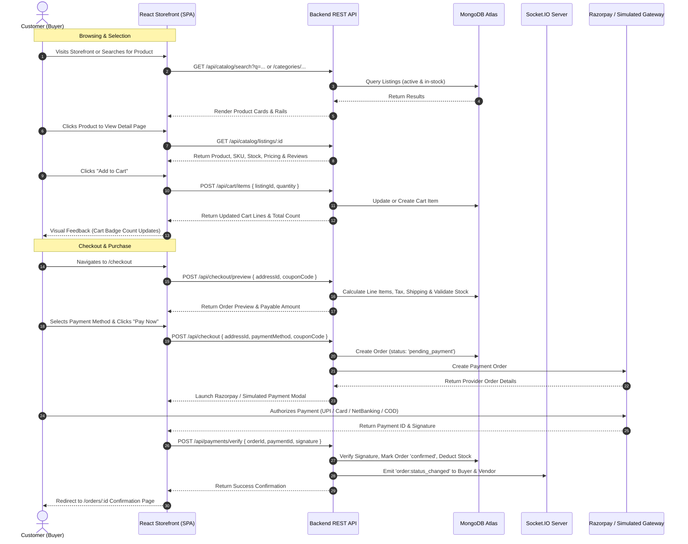
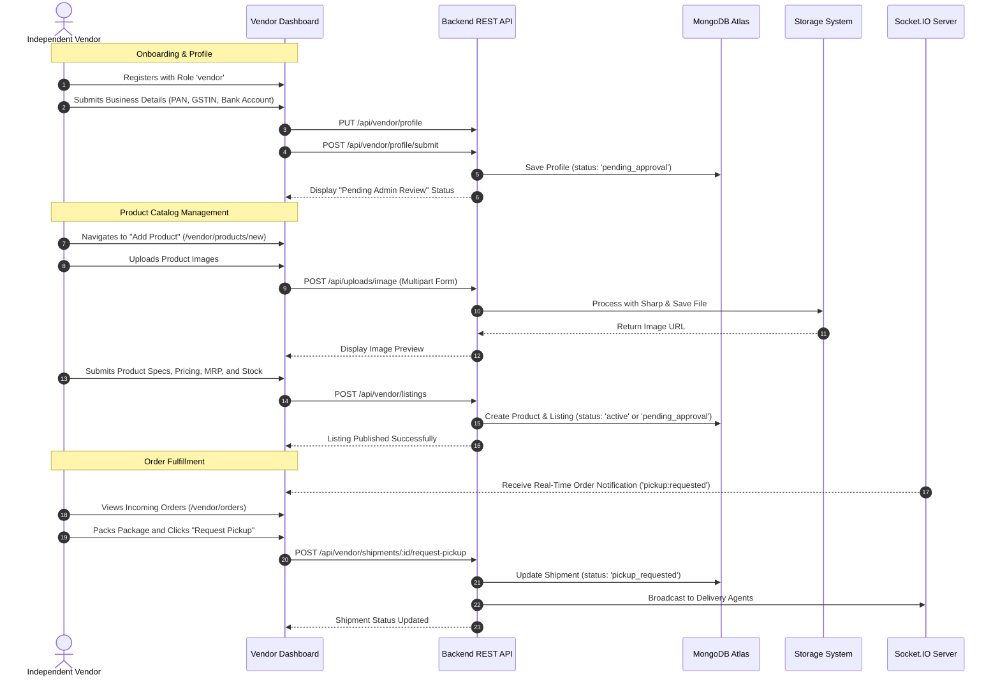
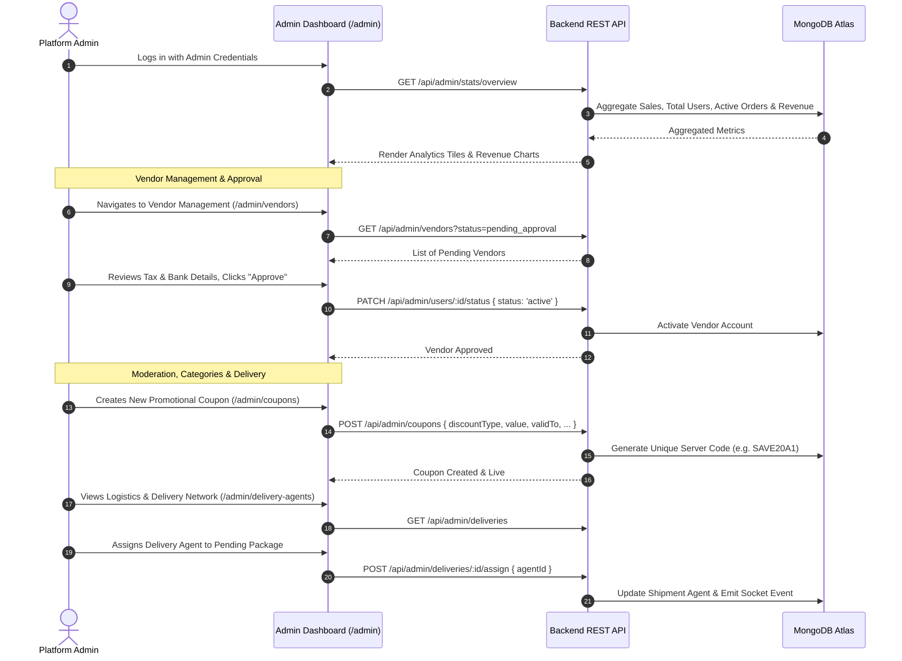
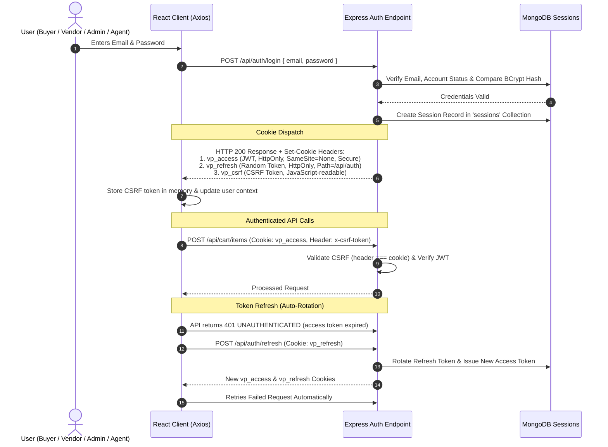

# VP Mart – Website Workflow Documentation
## End-to-End Operational Workflow Specifications

This document outlines the detailed workflows implemented in the VP Mart marketplace across Customer, Vendor, Admin, Authentication, and Payment domains.

---

## 1. Customer Workflow



---

## 2. Vendor Workflow



---

## 3. Admin Workflow



---

## 4. Authentication & Session Workflow

VP Mart implements a secure authentication flow using **HttpOnly Cookies** and **Double-Submit CSRF Protection**:



---

## 5. Checkout & Payment Workflow

```mermaid
flowchart TD
    Start(["User on Cart Page"]) --> Proceed["Clicks 'Proceed to Checkout'"]
    Proceed --> LoadCheckout["Load /checkout Page"]
    
    LoadCheckout --> FetchAddresses["Fetch User Saved Addresses\n(GET /api/addresses)"]
    FetchAddresses --> SelectAddress{"Address Selected\nor New Added?"}
    
    SelectAddress -->|Yes| Quote["Request Price Quote\n(POST /api/checkout/preview)"]
    Quote --> Calculate["Server Calculates:\n- Real-time Product Prices\n- Shipping Charges (PIN distance)\n- GST / Tax Breakdown\n- Coupon Discount (if applied)"]
    
    Calculate --> DisplaySummary["Display Detailed Order Summary\n& Payment Options"]
    DisplaySummary --> SelectPay["User Selects Payment Option:\n- UPI / QR Code\n- Credit / Debit Card\n- Net Banking\n- Wallet\n- Cash on Delivery (COD)"]
    
    SelectPay --> SubmitOrder["User Clicks 'Pay Now'"]
    SubmitOrder --> CreateOrderAPI["Call POST /api/checkout\n{ addressId, paymentMethod, couponCode }"]
    
    CreateOrderAPI --> CheckStock{"Validate Real-time Stock\nAvailability in DB"}
    CheckStock -->|Insufficient| StockError["Display Stock Depleted Error\nReturn to Cart"]
    CheckStock -->|Available| Reserve["Hold Inventory & Create Order Record\n(status: 'pending_payment')"]
    
    Reserve --> IsCOD{"Is Payment Method COD?"}
    IsCOD -->|Yes| MarkConfirmed["Set Order Status = 'confirmed'\nPayment Status = 'pending'"]
    
    IsCOD -->|No (Online)| LaunchPayment{"Check Razorpay Keys"}
    LaunchPayment -->|Configured| RealRazorpay["Launch Official Razorpay Modal\n(checkout.js)"]
    LaunchPayment -->|Not Configured| DummyRazorpay["Launch Simulated Razorpay Modal\n(RazorpayModal.jsx)"]
    
    RealRazorpay --> ProcessPayment["Customer Completes Payment"]
    DummyRazorpay --> ProcessPayment
    
    ProcessPayment --> VerifySig["POST /api/payments/verify\n{ orderId, paymentId, signature }"]
    VerifySig --> ValidSig{"HMAC-SHA256\nSignature Valid?"}
    
    ValidSig -->|No| FailPayment["POST /api/payments/failed\nOrder Status = 'cancelled'\nRelease Reserved Stock"]
    ValidSig -->|Yes| ConfirmOrder["Mark Order = 'confirmed'\nPayment Status = 'paid'\nClear User Cart in DB"]
    
    MarkConfirmed --> Redirect["Redirect to /orders/:id\nConfirmation & Live Tracking"]
    ConfirmOrder --> Redirect
    FailPayment --> RetryPay["Show Error & Offer Retry Payment"]
```
